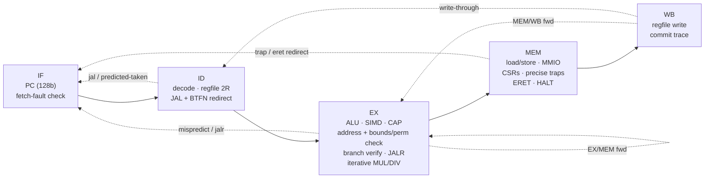

# TACHYON-128

**A real, working 128-bit CPU architecture — ISA, toolchain, golden model and a pipelined RTL core,
verified against each other.**

> 中文简介：TACHYON-128（超光速子-128）是一个从零设计的 128 位 CPU 架构：64 个 128 位寄存器、128 位地址空间、
> 定长 32 位指令；三大特色是 **硬件能力指针（CHERI 风格，边界+权限检查，不可伪造）**、**寄存器内 SIMD 通道**
> （16×8/8×16/4×32/2×64）和 **宽立即数拼接**。包含 Python 汇编器/反汇编器/黄金模拟器，SystemVerilog 五级流水线核心
> （前递、互锁、静态分支预测、迭代乘除法器），用 Verilator 与黄金模型逐条提交轨迹对比，全部测试通过；Yosys 综合给出单元数。
> 详细规范见 [SPEC.md](SPEC.md)（顶部有中文摘要）。

| | |
|---|---|
| Registers | 64 × 128-bit GPRs (`r0` = 0), each a *fat register* with a hidden capability tag + perms + base + top |
| Address space | 128-bit virtual, byte addressed, little-endian; 128-bit PC |
| Encoding | fixed 32-bit (op6 · rd6 · rs1·6 · rs2·6 · func8) — see SPEC §1.1 for why not 64-bit |
| Integer | add/sub/logic/shifts/compare/min/max/clz/ctz/popcnt, **128-bit mul, mulhu, div, divu, rem, remu** |
| Memory | 8/16/32/64/128-bit loads (signed/unsigned) and stores, naturally aligned |
| Feature 1 | **Capabilities** — CHERI-style unforgeable, monotonic, bounds- and permission-checked pointers |
| Feature 2 | **SIMD-in-GPR** — 16×8, 8×16, 4×32, 2×64 lanes: add/sub (wrap + saturating), min/max, compare masks, mul, splat, horizontal sum, shifts |
| Feature 3 | **Wide immediates** — `wli`/`wins` deposit 16 bits into any of 8 slots; `li` picks the shortest sequence |
| Traps | illegal, cap-tag, cap-bounds, cap-permission, misaligned, access-fault; precise; `tvec/epc/cause/tval`, `eret` |
| I/O | MMIO page at the very top of the 128-bit space: console, hex printer, exit |

## Quickstart

```bash
# toolchain (no root needed): Verilator + C++ compiler from conda-forge, Yosys as WebAssembly
micromamba create -n hdl -c conda-forge verilator gxx_linux-aarch64   # or gxx_linux-64
pip install --user yowasp-yosys

# assemble, disassemble, run on the golden model
python3 tools/asm.py programs/fib.s -o build/fib.bin --lst build/fib.lst
python3 tools/disasm.py build/fib.bin | head
python3 tools/sim.py build/fib.bin            # prints fib(180) = 18547707689471986212190138521399707760

# build the RTL model and run the whole differential test suite
make build           # Verilator model of tb/tb.sv + rtl/*.sv  -> build/vtb/Vtb
make test N=2000     # tool tests, unit tests, demo programs, 2000 random programs
make mutants         # inject 8 known RTL bugs, confirm the suite catches each
make synth           # Yosys generic-gate synthesis -> build/synth_stat.txt
```

Example output (golden model and RTL produce byte-identical console output):

```
fib(93) = 12200160415121876738
fib(94) = 19740274219868223167            <- first one past 64 bits
fib(180) = 18547707689471986212190138521399707760
34! = 295232799039604140847618609643520000000
high word of 34!*35 (mulhu) = 30          <- 35! no longer fits in 128 bits
dot(1..8,8..1)  = 00000000000000000000000000000078     (vmul.h + vsum.h)
vaddus.b (sat)  = fffffffffffffffffff0e0d0c0b0a090
bounded cap length = 64
  !! trap cause=3 addr=...270             <- store one past the end of a 64-byte capability
  !! trap cause=3 addr=...230             <- attempt to widen the capability
  !! trap cause=4 addr=...230             <- store through a read-only view
tag after mv (forge attempt) = 0
```

## Repository layout

```
SPEC.md               ISA specification (English, Chinese summary on top)
tools/isa.py          single source of truth: opcodes, funcs, CSRs, causes, memory map
tools/asm.py          two-pass assembler: labels, expressions, .include, data directives, pseudo-ops
tools/disasm.py       disassembler
tools/sim.py          golden reference ISA simulator (writes the commit trace)
programs/*.s          lib.s runtime + fib, fact, sort, simd, capfault demos
rtl/tx_core.sv        5-stage pipeline, register file, CSRs, traps, capability + memory checks
rtl/tx_alu.sv         128-bit ALU
rtl/tx_simd.sv        SIMD unit (per-width lane arrays)
rtl/tx_muldiv.sv      iterative multiplier/divider with result cache
rtl/tx_defs.svh       constants (checked against tools/isa.py by tests/test_tools.py)
tb/                   Verilator testbench: RAM, MMIO console, trace writer, C++ driver
tests/                harness, directed unit tests, random generator, mutation check, runner
synth/                Yosys scripts
```

## Microarchitecture



```
            +------+    +------+    +--------------------+    +---------+    +------+
  PC(128) ->|  IF  |--->|  ID  |--->|         EX         |--->|   MEM   |--->|  WB  |
            +------+    +------+    | ALU  SIMD  CAP  AGU|    | D-port  |    +------+
               ^          |  ^      | BR   MUL/DIV(iter) |    | CSR/trap|       |
               |          |  |      +--------------------+    +---------+       |
               |          |  +---- regfile 64 x {128b value + 261b capability} <+
               +----------+------------- redirects: ID (jal, backward br), EX (mispredict, jalr),
                                          MEM (trap, eret, halt)
```

* **Forwarding:** EX/MEM → EX and MEM/WB → EX (value *and* capability metadata); register file writes through to ID.
* **Interlocks:** 1-cycle bubble for load-use and CSR-read-use; the front end stalls while MUL/DIV iterates.
* **Branches:** JAL redirected in ID (1-cycle bubble); conditional branches statically predicted in ID
  (backward taken / forward not taken), verified in EX (2-cycle penalty on mispredict); JALR resolved in EX.
* **MUL/DIV:** radix-16 multiplier (32 iterations → full 256-bit product), radix-2 restoring divider that skips the
  dividend's leading zeros, instant divide-by-zero, and a one-entry result cache so `mulhu` after `mul` or `remu`
  after `divu` on the same operands costs no extra cycles.
* **Traps** are taken in MEM, so they are precise; younger instructions are flushed; stores and MMIO side effects
  only happen for non-trapping instructions in MEM.
* **Register file:** value and metadata arrays without reset (they map to memory macros) plus 64 "written" bits, so
  architectural reset (all zero, `rc` = root capability) costs 64 flops, not 25 000.

## Verification

The golden model writes a **commit trace** — one line per retired instruction (`pc rd value tag [perm base top]`)
and one line per trap (`T cause epc tval`). The Verilator testbench writes the same trace from the WB stage.
For every test the harness requires: identical traces (lock-step architectural state, including capability
metadata), identical console bytes, identical final 256 KiB RAM image, identical retired count and exit code.

| Suite | Result | Notes |
|---|---|---|
| Tool self-tests (`tests/test_tools.py`) | **PASS** | 61 ISA constants in sync between Python and RTL; 1054 random `li` constants exact (avg 3.35 instr); 9462-instruction disasm→asm round trip |
| Directed unit tests (`tests/unit_tests.py`) | **133 / 133** | every ALU/MULDIV op, all 75 SIMD op×lane combos, immediates, wide imm, all loads/stores, all branches, jumps, every capability op, CSRs/ERET, all trap causes, hazards (load-use, forwarding chains, MUL/DIV under flush, dense branches), MMIO exit |
| Demo programs | **5 / 5** | fib(180), 30!..34! exact (+mulhu overflow), 24×128-bit insertion sort, SIMD demo, capability-fault demo — also checked against independent Python results |
| Random differential (`tests/random_tests.py`) | **2000 / 2000** | 1 090 156 instructions retired; every class incl. random traps (≈ 1580 traps per 60 programs: tag/bounds/perm/align/access/illegal) |
| Mutation check (`tests/mutants.py`) | **8 / 8 caught** | removed MEM/WB forwarding, removed load-use stall, off-by-one bounds check, wrong SIMD saturation, divider cache ignoring an operand, missed taken-mispredict, non-monotonic `csetbnd`, missing WB write-through |

### Performance (cycle-accurate RTL, CPI = cycles / retired instructions)

| Workload | Cycles | Retired | CPI |
|---|---:|---:|---:|
| fib (7 Fibonacci numbers, decimal printing) | 14 681 | 6 476 | 2.27 |
| fact (30!..34!, decimal printing) | 16 498 | 2 838 | 5.81 |
| sort (24 × 128-bit keys) | 2 868 | 1 564 | 1.83 |
| simd demo | 1 309 | 916 | 1.43 |
| capfault demo | 1 574 | 1 073 | 1.47 |
| all 133 unit tests | 15 191 | 9 185 | 1.65 |
| 2000 random programs | 2 069 764 | 1 090 156 | 1.90 |

fib/fact are dominated by software decimal printing, i.e. 128-bit divides (up to 129 cycles each; the paired
`remu` hits the result cache). Integer/SIMD/capability code runs at CPI ≈ 1.4–1.9.

### Synthesis (Yosys 0.70, generic gates)

Full reports: `results/synth_stat_abc.txt` (hierarchical, ABC-mapped — `make synth`) and `results/synth_stat_techmap.txt` (techmap only).
The register file is kept as memory macros (`$mem_v2`, 64×128 b and 64×261 b, 2 read / 1 write), as a
real implementation would use a register-file compiler.

| Block (hierarchical, after ABC) | Cells |
|---|---:|
| **tx_core total** | **93 056** |
| ├ tx_alu (128-bit ALU incl. barrel shifters, clz/ctz/popcnt) | 8 124 |
| ├ tx_muldiv (iterative mul/div + result cache) | 11 539 |
| ├ tx_simd (8/16/32/64-bit lane arrays incl. 28 lane multipliers) | 48 052 |
| └ core glue (pipeline regs, forwarding, capability checks, CSRs, decode) | 25 341 |
| of which flip-flops | 4 919 |
| of which register-file memory macros (`$mem_v2`) | 3 |
| combinational gates (AND/NAND/OR/NOR/XOR/XNOR/MUX/NOT…) | 88 134 |

Techmap-only (no ABC) count: 107 346 cells. Synthesis runtime ≈ 35 s (WebAssembly Yosys).
The SIMD unit dominates area because every lane width has its own datapath; sharing one
segmented adder/multiplier array across widths is the obvious next optimisation.

## Known gaps (v1)

* No tagged memory: capabilities cannot be spilled to memory (stores strip the tag) — v2 would add a tag bit per 16 B.
* No capability-checked instruction fetch, no sealing; single privilege level.
* No MMU (flat 128-bit space, 256 KiB physical RAM), no interrupts, no FPU/atomics, no self-modifying-code fence.
* Divider is radix-2 (up to 129 cycles); a radix-4/SRT divider would cut fib/fact CPI substantially.
* Synthesis is technology-independent (no timing/area on a real cell library); no FPGA bring-up yet.
