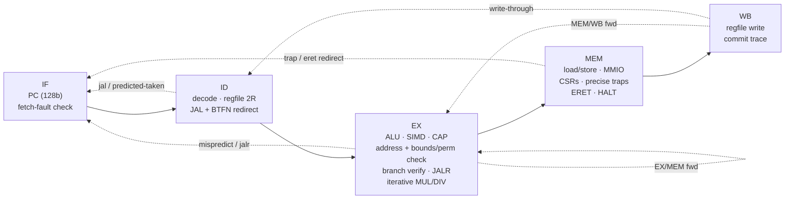

# TACHYON-128

**A real, working 128-bit CPU architecture — ISA, toolchain, golden model and a pipelined RTL core,
verified against each other.**

> 中文简介：TACHYON-128（超光速子-128）是一个从零设计的 128 位 CPU 架构：64 个 128 位寄存器、128 位地址空间、
> 定长 32 位指令；三大特色是 **硬件能力指针（CHERI 风格，边界+权限检查，不可伪造）**、**寄存器内 SIMD 通道**
> （16×8/8×16/4×32/2×64）和 **宽立即数拼接**。v2 新增：**带标签内存**（`clc`/`csc`，每 16 字节一个影子 tag+元数据）、
> **PCC 取指能力检查**（`cjalr`）、**密封能力**（`cseal`/`cunseal`）、**radix-4 提前终止除法器**、**确定性定时器中断**。
> 包含 Python 汇编器/反汇编器/黄金模拟器，SystemVerilog 五级流水线核心，用 Verilator 与黄金模型逐条提交轨迹对比，全部测试通过；Yosys 综合给出单元数。
> 详细规范见 [SPEC.md](SPEC.md)（顶部有中文摘要）。

| | |
|---|---|
| Registers | 64 × 128-bit GPRs (`r0` = 0), each a *fat register* with a hidden capability tag + perms + base + top |
| Address space | 128-bit virtual, byte addressed, little-endian; 128-bit PC |
| Encoding | fixed 32-bit (op6 · rd6 · rs1·6 · rs2·6 · func8) — see SPEC §1.1 for why not 64-bit |
| Integer | add/sub/logic/shifts/compare/min/max/clz/ctz/popcnt, **128-bit mul, mulhu, div, divu, rem, remu** |
| Memory | 8/16/32/64/128-bit loads (signed/unsigned) and stores, naturally aligned |
| Feature 1 | **Capabilities** — CHERI-style unforgeable, monotonic, bounds- and permission-checked pointers; **v2:** tagged memory (`clc`/`csc`, shadow tag + metadata per 16-byte granule), capability-checked instruction fetch (PCC, `cjalr`), sealed capabilities (`cseal`/`cunseal`) |
| Feature 2 | **SIMD-in-GPR** — 16×8, 8×16, 4×32, 2×64 lanes: add/sub (wrap + saturating), min/max, compare masks, mul, splat, horizontal sum, shifts |
| Feature 3 | **Wide immediates** — `wli`/`wins` deposit 16 bits into any of 8 slots; `li` picks the shortest sequence |
| Traps | illegal, cap-tag, cap-bounds, cap-permission, misaligned, access-fault, cap-sealed; precise; `tvec/epc/cause/tval/status`, `eret` |
| Interrupts | **v2:** machine timer — `mtime` = retired-instruction count (deterministic), `mtimecmp`, `status.IE/PIE/TIE`, precise delivery |
| I/O | MMIO page at the very top of the 128-bit space: console, hex printer, exit, mtime, mtimecmp |

## Quickstart

```bash
# toolchain (no root needed): Verilator + C++ compiler from conda-forge, Yosys as WebAssembly
bash tb/setup_toolchain.sh && source ~/env.sh     # micromamba env "hdl" + yowasp-yosys

# assemble, disassemble, run on the golden model
python3 tools/asm.py programs/fib.s -o build/fib.bin --lst build/fib.lst
python3 tools/disasm.py build/fib.bin | head
python3 tools/sim.py build/fib.bin            # prints fib(180) = 18547707689471986212190138521399707760

# build the RTL model and run the whole differential test suite
make build           # Verilator model of tb/tb.sv + rtl/*.sv  -> build/vtb/Vtb
make test N=2000     # tool tests, unit tests, demo programs, 2000 random programs
make mutants         # inject 20 known RTL bugs, confirm the suite catches each
make synth           # Yosys generic-gate synthesis -> build/synth_stat.txt
```

Example output (golden model and RTL produce byte-identical console output):

```
fib(93) = 12200160415121876738
fib(94) = 19740274219868223167            <- first one past 64 bits
fib(180) = 18547707689471986212190138521399707760
34! = 295232799039604140847618609643520000000
high word of 34!*35 (mulhu) = 30          <- 35! no longer fits in 128 bits
dot(1..8,8..1)  = 00000000000000000000000000000078     (vmul.h + vsum.h)
vaddus.b (sat)  = fffffffffffffffffff0e0d0c0b0a090
bounded cap length = 64
  !! trap cause=3 addr=...270             <- store one past the end of a 64-byte capability
  !! trap cause=3 addr=...230             <- attempt to widen the capability
  !! trap cause=4 addr=...230             <- store through a read-only view
tag after mv (forge attempt) = 0
nodes walked        = 6                  <- caplist: linked list of capabilities spilled with csc / reloaded with clc
payload sum         = 00000015000000000000000000000015
nodes after forge   = 3                  <- an integer store into a link cleared the granule's tag: list is cut
  !! trap cause=2 / 3 / 4                <- forged pointer, neighbour access, csc through a load-only view
....................                     <- timer: one '.' per interrupt (mtime counts retired instructions)
timer ticks       = 20
```

## Repository layout

```
SPEC.md               ISA specification (English, Chinese summary on top)
tools/isa.py          single source of truth: opcodes, funcs, CSRs, causes, memory map
tools/asm.py          two-pass assembler: labels, expressions, .include, data directives, pseudo-ops
tools/disasm.py       disassembler
tools/sim.py          golden reference ISA simulator (writes the commit trace)
programs/*.s          lib.s runtime + fib, fact, sort, simd, capfault, caplist (tagged memory), timer (interrupts)
rtl/tx_core.sv        5-stage pipeline, register file, CSRs, traps/interrupts, PCC, capability + memory checks, timer
rtl/tx_alu.sv         128-bit ALU
rtl/tx_simd.sv        SIMD unit (per-width lane arrays)
rtl/tx_muldiv.sv      radix-16 multiplier, radix-4 early-terminating divider, result cache
rtl/tx_defs.svh       constants (checked against tools/isa.py by tests/test_tools.py)
tb/                   Verilator testbench: RAM + shadow tag memory, MMIO console, trace writer, C++ driver, toolchain setup
tests/                harness, directed unit tests, random generator, mutation check, runner
synth/                Yosys scripts
```

## Microarchitecture



```
            +------+    +------+    +--------------------+    +---------+    +------+
  PC(128) ->|  IF  |--->|  ID  |--->|         EX         |--->|   MEM   |--->|  WB  |
            +------+    +------+    | ALU  SIMD  CAP  AGU|    | D-port  |    +------+
               ^          |  ^      | BR   MUL/DIV(iter) |    | CSR/trap|       |
               |          |  |      +--------------------+    +---------+       |
               |          |  +---- regfile 64 x {128b value + 261b capability} <+
               +----------+------------- redirects: ID (jal, backward br), EX (mispredict, jalr),
                                          MEM (trap, eret, halt)
```

* **Forwarding:** EX/MEM → EX and MEM/WB → EX (value *and* capability metadata); register file writes through to ID.
* **Interlocks:** 1-cycle bubble for load-use and CSR-read-use; the front end stalls while MUL/DIV iterates.
* **Branches:** JAL redirected in ID (1-cycle bubble); conditional branches statically predicted in ID
  (backward taken / forward not taken), verified in EX (2-cycle penalty on mispredict); JALR resolved in EX.
* **MUL/DIV:** radix-16 multiplier (32 iterations → full 256-bit product). **v2 divider:** radix-4 restoring
  (4R+d compared against B, 2B, 3B in parallel), two radix-4 steps chained per cycle by default (4 quotient
  bits/cycle; `+define+TX_DIV_STEPS=1` = plain radix-4), with operand-normalised early termination — only
  `sig(|a|) − sig(|b|) + 1` quotient bits are computed. Latency ≈ `ceil(n/4) + 2` cycles (≤ ≈34, was ≤ 129 in v1);
  instant divide-by-zero; one-entry result cache so `remu` after `divu` (or `mulhu` after `mul`) is free.
* **Tagged memory:** the data port carries a 281-bit metadata side-band; the testbench memory system keeps one
  shadow entry {tag, otype, perm, base, top} per 16-byte granule. `csc` writes it, every other RAM store writes 0
  (clearing the tag), `clc` returns it (forwarded like any load, with the load-use interlock).
* **PCC:** a fetch-side PCC (updated with the `cjalr` redirect in EX) checks EXEC + bounds on every fetch; the
  architectural PCC/EPCC are updated in MEM so traps and interrupts save the right one.
* **Interrupts:** the timer condition is evaluated against the instruction in MEM — the oldest one, after all older
  instructions have updated `mtime` (retire count), `mtimecmp` and `status` — and the interrupt replaces it before it
  has any effect. Because `mtime` counts retirements, delivery lands exactly where the ISA model puts it.
* **Traps** are taken in MEM, so they are precise; younger instructions are flushed; stores and MMIO side effects
  only happen for non-trapping instructions in MEM.
* **Register file:** value and metadata arrays without reset (they map to memory macros) plus 64 "written" bits, so
  architectural reset (all zero, `rc` = root capability) costs 64 flops, not 26 000.

## Verification

The golden model writes a **commit trace** — one line per retired instruction (`pc rd value tag [perm base top otype]`),
one line per trap (`T cause epc tval`) and one per interrupt (`I code epc`). The Verilator testbench writes the
same trace from the WB stage. For every test the harness requires: identical traces (lock-step architectural state,
including capability metadata and every interrupt delivery point), identical console bytes, identical final 256 KiB
RAM image, **identical shadow tag memory** (every tagged granule with its metadata), identical retired count and exit code.

| Suite | Result | Notes |
|---|---|---|
| Tool self-tests (`tests/test_tools.py`) | **PASS** | 72 ISA constants in sync between Python and RTL (opcodes, counts, causes, ALU + CAP funcs, MMIO); 1054 random `li` constants exact (avg 3.35 instr); 11 737-instruction disasm→asm round trip |
| Directed unit tests (`tests/unit_tests.py`) | **150 / 150** | v1's 133 + 17 new: divider width edges (3), tagged memory (`capmem_basic/perms/hazards`), PCC (`pcc_call/faults/eret_restore`), sealing (`seal_ops`, `seal_hazards`), timer interrupts (`irq_periodic/mixed/pcc/enable_pending/mmio_regs/nohandler`) |
| Demo programs | **7 / 7** | fib(180), 30!..34! exact (+mulhu overflow), 24×128-bit sort, SIMD, capability faults, **caplist** (capability linked list in tagged memory), **timer** (deterministic ticks) — each also checked against independent Python results |
| Random differential (`tests/random_tests.py`) | **2000 / 2000** (+ 2000/2000 on seeds 100001…, + 2000/2000 on the radix-4 build) | 1 687 421 instructions retired; per 2000 programs ≈ 21 100 timer interrupts, 63 000 traps of all 7 causes (incl. 1 170 cap-sealed, ≈ 1 850 PCC fetch faults), 2 670 tagged `clc` reloads, 14 560 successful `cjalr` calls/returns |
| Mutation check (`tests/mutants.py`) | **20 / 20 caught** | v1's 8 + tag not cleared by data stores, `clc` ignoring LOAD_CAP, `csc` without STORE_CAP check, no PCC top check, `eret` not restoring the fetch PCC, sealed deref allowed, `cunseal` without otype check, radix-4 never picking digit 3, early-termination off-by-one, interrupt ignoring TIE, `mtime` counting traps, interrupted store not squashed (`results/mutants.txt`) |

### Performance (cycle-accurate RTL, CPI = cycles / retired instructions)

| Workload | Cycles | Retired | CPI v2 (default, 4 b/cycle) | CPI v2 radix-4 (2 b/cycle) | CPI v1 (radix-2) |
|---|---:|---:|---:|---:|---:|
| fib (7 Fibonacci numbers, decimal printing) | 9 837 | 6 476 | **1.52** | 1.74 | 2.27 |
| fact (30!..34!, decimal printing) | 8 030 | 2 838 | **2.83** | 3.74 | 5.81 |
| sort (24 × 128-bit keys) | 2 868 | 1 564 | 1.83 | 1.83 | 1.83 |
| simd demo | 1 309 | 916 | 1.43 | 1.43 | 1.43 |
| capfault demo | 1 558 | 1 073 | 1.45 | 1.45 | 1.47 |
| caplist demo (tagged memory) | 2 181 | 1 537 | 1.42 | 1.42 | — |
| timer demo (20 interrupts) | 7 330 | 5 824 | 1.26 | 1.26 | — |
| all 150 unit tests | 25 111 | 15 028 | 1.67 | 1.84 | — |
| 2000 random programs (v2 generator) | 3 065 584 | 1 687 421 | 1.82 | 1.88 | — |

fib/fact are dominated by software decimal printing (`divu`/`remu` by 10 of 128-bit numbers). With early
termination a divide by 10 of an n-bit number now takes ≈ n/4 + 2 cycles instead of n + 1, and the paired `remu`
still hits the result cache. fact keeps a higher CPI because of its 32-cycle iterative 128×128 multiplies.

### Synthesis (Yosys 0.70, generic gates)

Full reports: `results/synth_stat_abc.txt` (hierarchical, ABC-mapped — `make synth`) and `results/synth_stat_techmap.txt` (techmap only).
The register file is kept as memory macros (`$mem_v2`, 64×128 b and 64×281 b, 2 read / 1 write), as a
real implementation would use a register-file compiler. The shadow tag memory lives in the memory system
(testbench), not in `tx_core`, just like RAM.

| Block (hierarchical, after ABC) | v2 cells | v1 cells |
|---|---:|---:|
| **tx_core total** | **113 509** | 93 056 |
| ├ tx_alu (128-bit ALU incl. barrel shifters, clz/ctz/popcnt) | 8 124 | 8 124 |
| ├ tx_muldiv (mul + radix-4 ×2/cycle early-terminating divider + result cache) | 17 235 | 11 539 |
| ├ tx_simd (8/16/32/64-bit lane arrays incl. 28 lane multipliers) | 48 052 | 48 052 |
| └ core glue (pipeline, forwarding, capability/PCC/seal checks, CSRs, timer, decode) | 40 098 | 25 341 |
| of which flip-flops | 7 042 | 4 919 |
| of which register-file memory macros (`$mem_v2`) | 3 | 3 |
| combinational gates (AND/NAND/OR/NOR/XOR/XNOR/MUX/NOT…) | 106 464 | 88 134 |

Plain radix-4 build (`-DTX_DIV_STEPS=1`, `results/synth_stat_abc_div_radix4.txt`): tx_muldiv 14 248, total 110 522.
Techmap-only (no ABC) count: 129 483 cells (v1: 107 346). ABC synthesis runtime ≈ 130 s (WebAssembly Yosys).
The core glue grew mostly from the wider capability side-band (261 → 281 bits through the pipeline), the PCC/EPCC
registers, the sealing checks and the 128-bit `mtime`/`mtimecmp` comparator. The SIMD unit still dominates area
because every lane width has its own datapath; sharing one segmented adder/multiplier array is the obvious next optimisation.

## Known gaps (v2)

* Sealing is minimal: no sealed entry points (sentries / `CInvoke`), no LOAD_MUTABLE/GLOBAL-style permissions;
  capability permissions are not transitively reduced on `clc`.
* Capabilities keep full-precision bounds, so each 16-byte granule needs a 281-bit shadow entry (no CHERI-style
  bounds compression); `mtime` is a retired-instruction counter, not wall-clock time; single interrupt source.
* Single privilege level; no MMU (flat 128-bit space, 256 KiB physical RAM), no FPU/atomics, no self-modifying-code fence.
* Multiplier is still iterative (32 cycles); synthesis is technology-independent (no timing/area on a real cell
  library; the chained radix-4 divider step doubles the divider's critical path); no FPGA bring-up yet.
