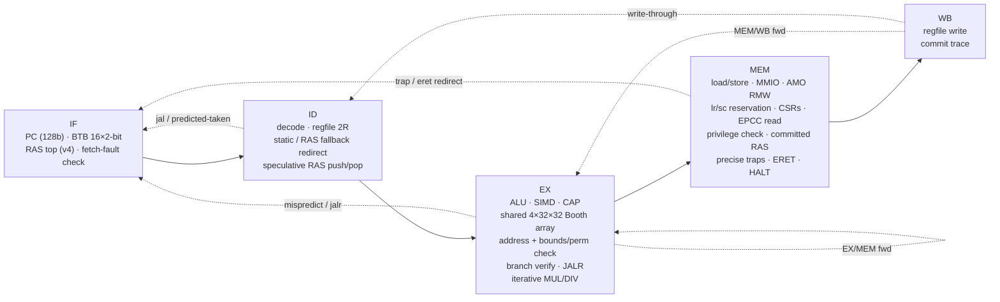

# TACHYON-128

**A real, working 128-bit CPU architecture — ISA, toolchain, golden model and a pipelined RTL core,
verified against each other.**

> 中文简介：TACHYON-128（超光速子-128）是一个从零设计的 128 位 CPU 架构：64 个 128 位寄存器、128 位地址空间、
> 定长 32 位指令；三大特色是 **硬件能力指针（CHERI 风格，边界+权限检查，不可伪造）**、**寄存器内 SIMD 通道**
> （16×8/8×16/4×32/2×64）和 **宽立即数拼接**。v2 新增：**带标签内存**（`clc`/`csc`，每 16 字节一个影子 tag+元数据）、
> **PCC 取指能力检查**（`cjalr`）、**密封能力**（`cseal`/`cunseal`）、**radix-4 提前终止除法器**、**确定性定时器中断**。
> **v3 新增**：**4 遍 radix-2³² 乘法器**（6 周期，原 35 周期）、**密封入口能力 sentry 与 `cinvoke` 保护域调用**、
> **`clc` 深度只读权限衰减**、**用户/内核两级特权**（`ecall`、特权违例陷阱、用户态 MMIO 只能经能力访问，附带抢占式双任务小内核示例）、
> **分支目标缓冲 BTB + 2 位饱和计数器预测**。
> **v4 新增**：**乘法器面积缩小**（标量乘法与 SIMD `vmul` 共享一块可拆分的 radix-4 Booth 4×(32×32) 乘法阵列，仍 6 周期，
> 核心总面积 −10.6%）、**8 项返回地址栈 RAS**（递归程序 CPI 1.293→1.166）、**CHERI 风格新权限位** GLOBAL / LOAD_MUTABLE /
> PERMIT_CINVOKE / STORE_LOCAL（局部能力只能经带 STORE_LOCAL 的能力存储；`clc` 衰减改由 LOAD_MUTABLE 决定）、
> **128 位原子操作** `lr`/`sc`/`amoswap`/`amoadd`/`amoand`/`amoor`/`amoxor`（`lr`/`sc`/`amoswap` 保留能力标签）、**可读 EPCC**（`cgetepcc`）。
> 包含 Python 汇编器/反汇编器/黄金模拟器，SystemVerilog 五级流水线核心，用 Verilator 与黄金模型逐条提交轨迹对比，全部测试通过；Yosys 综合给出单元数。
> 详细规范见 [SPEC.md](SPEC.md)（顶部有中文摘要）。

| | |
|---|---|
| Registers | 64 × 128-bit GPRs (`r0` = 0), each a *fat register* with a hidden capability tag + perms + base + top |
| Address space | 128-bit virtual, byte addressed, little-endian; 128-bit PC |
| Encoding | fixed 32-bit (op6 · rd6 · rs1·6 · rs2·6 · func8) — see SPEC §1.1 for why not 64-bit |
| Integer | add/sub/logic/shifts/compare/min/max/clz/ctz/popcnt, **128-bit mul, mulhu, div, divu, rem, remu** (v3: 6-cycle 4-pass multiplier; v4: its 128×32 array is shared with SIMD `vmul`) |
| Memory | 8/16/32/64/128-bit loads (signed/unsigned) and stores, naturally aligned; **v4:** 128-bit atomics `lr`/`sc`, `amoswap`/`amoadd`/`amoand`/`amoor`/`amoxor` (single hart, capability-aware) |
| Feature 1 | **Capabilities** — CHERI-style unforgeable, monotonic, bounds- and permission-checked pointers; **v2:** tagged memory (`clc`/`csc`, shadow tag + metadata per 16-byte granule), capability-checked instruction fetch (PCC, `cjalr`), sealed capabilities (`cseal`/`cunseal`); **v3:** sealed entry capabilities (`csealentry`, sentry `cjalr`), `cinvoke` sealed code+data domain calls, deep read-only `clc` attenuation; **v4:** CHERI permissions GLOBAL / STORE_LOCAL (local capabilities), LOAD_MUTABLE (drives `clc` attenuation), PERMIT_CINVOKE; supervisor-readable EPCC (`cgetepcc`) |
| Feature 2 | **SIMD-in-GPR** — 16×8, 8×16, 4×32, 2×64 lanes: add/sub (wrap + saturating), min/max, compare masks, mul, splat, horizontal sum, shifts |
| Feature 3 | **Wide immediates** — `wli`/`wins` deposit 16 bits into any of 8 slots; `li` picks the shortest sequence |
| Traps | illegal, cap-tag, cap-bounds, cap-permission, misaligned, access-fault, cap-sealed, **v3:** environment-call, privilege-violation; precise; `tvec/epc/cause/tval/status/ubase/ubound`, `eret` |
| Privilege | **v3:** supervisor + user mode (`status.U/PU`), `ecall`; user mode cannot touch CSRs, `eret`, `halt`, `csetepcc`, and reaches memory/MMIO through untagged pointers only inside `[ubase, ubound)` — devices only through capabilities the kernel grants |
| Interrupts | **v2:** machine timer — `mtime` = retired-instruction count (deterministic), `mtimecmp`, `status.IE/PIE/TIE`, precise delivery |
| I/O | MMIO page at the very top of the 128-bit space: console, hex printer, exit, mtime, mtimecmp |

## Quickstart

```bash
# toolchain (no root needed): Verilator + C++ compiler from conda-forge, Yosys as WebAssembly
bash tb/setup_toolchain.sh && source ~/env.sh     # micromamba env "hdl" + yowasp-yosys

# assemble, disassemble, run on the golden model
python3 tools/asm.py programs/fib.s -o build/fib.bin --lst build/fib.lst
python3 tools/disasm.py build/fib.bin | head
python3 tools/sim.py build/fib.bin            # prints fib(180) = 18547707689471986212190138521399707760

# build the RTL model and run the whole differential test suite
make build           # Verilator model of tb/tb.sv + rtl/*.sv  -> build/vtb/Vtb
make test N=2000     # tool tests, multiplier-array check, unit tests, demo programs, 2000 random programs
make mutants         # inject 60 known RTL bugs, confirm the suite catches each
make synth           # Yosys generic-gate synthesis -> build/synth_stat.txt
```

Example output (golden model and RTL produce byte-identical console output):

```
fib(93) = 12200160415121876738
fib(94) = 19740274219868223167            <- first one past 64 bits
fib(180) = 18547707689471986212190138521399707760
34! = 295232799039604140847618609643520000000
high word of 34!*35 (mulhu) = 30          <- 35! no longer fits in 128 bits
dot(1..8,8..1)  = 00000000000000000000000000000078     (vmul.h + vsum.h)
vaddus.b (sat)  = fffffffffffffffffff0e0d0c0b0a090
bounded cap length = 64
  !! trap cause=3 addr=...270             <- store one past the end of a 64-byte capability
  !! trap cause=3 addr=...230             <- attempt to widen the capability
  !! trap cause=4 addr=...230             <- store through a read-only view
tag after mv (forge attempt) = 0
nodes walked        = 6                  <- caplist: linked list of capabilities spilled with csc / reloaded with clc
payload sum         = 00000015000000000000000000000015
nodes after forge   = 3                  <- an integer store into a link cleared the granule's tag: list is cut
  !! trap cause=2 / 3 / 4 / 4            <- forged pointer, neighbour access, csc through a load-only view,
                                            v4: a local (non-GLOBAL) stack capability stored into the heap
local cap reloaded from stack, tag = 1   <- ...but it may be spilled to the stack (authority has STORE_LOCAL)
....................                     <- timer: one '.' per interrupt (mtime counts retired instructions)
timer ticks       = 20
TACHYON-128 kernel: 2 user tasks, timer quantum 200        <- kernel: supervisor + two preempted user tasks
Aabcd0efgh ijklAmn                                          <- task A via ecall, task B via a console capability
[kernel] task 1 killed: cause=9 tval=ffffffffffffffffffffffffffff0000   <- untagged MMIO store from user mode
1 A2 A3 A4 A5 A6 A7 A8 A9
[kernel] exit from task 0
[kernel] all tasks finished. preemptions=34 ecalls=32 taskA counter=10
rfib(18)    = 2584                       <- recurse (v4): call-heavy RAS benchmark
ack(2, 3)   = 9
tree sum    = 2016                       <- recursive walk of a binary tree linked by capabilities
```

## Repository layout

```
SPEC.md               ISA specification (English, Chinese summary on top)
tools/isa.py          single source of truth: opcodes, funcs, CSRs, causes, memory map
tools/asm.py          two-pass assembler: labels, expressions, .include, data directives, pseudo-ops
tools/disasm.py       disassembler
tools/sim.py          golden reference ISA simulator (writes the commit trace)
programs/*.s          lib.s runtime + fib, fact, sort, simd, capfault, caplist (tagged memory), timer (interrupts),
                      kernel (v3: supervisor/user, two preempted user tasks, ecall, capability-granted MMIO;
                      v4: saves the preempted PCC with cgetepcc), recurse (v4: recursion benchmark)
rtl/tx_core.sv        5-stage pipeline, register file, CSRs, traps/interrupts, PCC, capability + memory checks, timer
rtl/tx_alu.sv         128-bit ALU
rtl/tx_simd.sv        SIMD unit (per-width lane arrays)
rtl/tx_muldiv.sv      4-pass radix-2^32 multiplier control + accumulator, radix-4 early-terminating divider, result cache
rtl/tx_mul32x4.sv     v4: shared fracturable radix-4 Booth array, 4 x (32x32 | 2x16x16 | 4x8x8), scalar mul + SIMD vmul
rtl/tx_defs.svh       constants (checked against tools/isa.py by tests/test_tools.py)
tb/                   Verilator testbench: RAM + shadow tag memory, MMIO console, trace writer, C++ driver, toolchain setup
tests/                harness, directed unit tests (+ cycle bounds), random generator, mutation check, runner, coverage.py,
                      test_mul32x4.sh (standalone multiplier-array check vs C, both implementations)
synth/                Yosys scripts
```

## Microarchitecture



```
            +------+    +------+    +--------------------+    +---------+    +------+
  PC(128) ->|  IF  |--->|  ID  |--->|         EX         |--->|   MEM   |--->|  WB  |
            +------+    +------+    | ALU  SIMD  CAP  AGU|    | D-port  |    +------+
               ^          |  ^      | BR   MUL/DIV(iter) |    | CSR/trap|       |
               |          |  |      +--------------------+    +---------+       |
               |          |  +---- regfile 64 x {128b value + 285b capability} <+
               +----------+------------- redirects: ID (jal, backward br), EX (mispredict, jalr),
                                          MEM (trap, eret, halt)
```

* **Forwarding:** EX/MEM → EX and MEM/WB → EX (value *and* capability metadata); register file writes through to ID.
* **Interlocks:** 1-cycle bubble for load-use and CSR-read-use; the front end stalls while MUL/DIV iterates.
* **Branches (v3):** a 16-entry direct-mapped **branch target buffer** with 2-bit saturating counters predicts taken
  branches, `jal` and `jalr` (last target, e.g. returns) in IF with no bubble. On a BTB miss ID falls back to the
  v2 static rule (JAL and backward branches redirect, 1 bubble). Every instruction carries its predicted next pc;
  EX compares it with the real one and redirects on any difference (2-cycle penalty), so aliasing or stale targets
  only cost time. `cjalr`/`cinvoke` always redirect from EX (they switch the fetch PCC). `+define+TX_NO_BTB` = v2.
* **Return address stack (v4):** 8 entries; `jal`/`jalr` writing `ra` push, `jalr` through `ra` (not writing it) pops.
  BTB entries carry a return bit so a BTB hit on a return takes the RAS top; a return the BTB has not seen is predicted
  from the RAS in ID. Speculative copy updated as calls/returns leave ID (with an IF bypass), committed copy updated in MEM
  and restored on every MEM redirect. `+define+TX_NO_RAS` removes it. Unit tests carry cycle bounds so a silently broken
  predictor fails the suite (prediction is invisible to the ISA, so the trace diff alone cannot catch it).
* **Shared multiplier array (v4):** one `tx_mul32x4` (four fracturable radix-4 Booth 32×32 multipliers: 1×32×32, 2×16×16
  or 4×8×8 exact products each) serves both the scalar multiplier's 128×32 passes and SIMD `vmul.b/.h/.w`; the SIMD lane
  arrays no longer contain multipliers. While a `mul` iterates EX holds it, so the two users never collide. Latency is
  unchanged. `+define+TX_MUL_ANDARRAY` = same function as a masked AND array.
* **Atomics (v4):** `lr`/`sc`/AMOs use the normal EX address/check path (address = rs1) and perform the read-modify-write
  in MEM in one cycle (combinational read, synchronous write); results come from MEM like loads (load-use interlock).
  The reservation register lives in MEM, so its set/clear order is exactly program order.
* **MUL/DIV:** **v3 multiplier:** 4 passes of a 128 × 32 partial-product array into a 256-bit accumulator
  (6 cycles in EX, was 35 with v2's radix-16 shift-add; `+define+TX_MUL_BITS=4` rebuilds the v2 datapath). **v2 divider:** radix-4 restoring
  (4R+d compared against B, 2B, 3B in parallel), two radix-4 steps chained per cycle by default (4 quotient
  bits/cycle; `+define+TX_DIV_STEPS=1` = plain radix-4), with operand-normalised early termination — only
  `sig(|a|) − sig(|b|) + 1` quotient bits are computed. Latency ≈ `ceil(n/4) + 2` cycles (≤ ≈34, was ≤ 129 in v1);
  instant divide-by-zero; one-entry result cache so `remu` after `divu` (or `mulhu` after `mul`) is free.
* **Tagged memory:** the data port carries a 285-bit (v3: 281) metadata side-band; the testbench memory system keeps one
  shadow entry {tag, otype, perm, base, top} per 16-byte granule. `csc` writes it, every other RAM store writes 0
  (clearing the tag), `clc` returns it (forwarded like any load, with the load-use interlock).
* **PCC:** a fetch-side PCC (updated with the `cjalr` redirect in EX) checks EXEC + bounds on every fetch; the
  architectural PCC/EPCC are updated in MEM so traps and interrupts save the right one.
* **Interrupts:** the timer condition is evaluated against the instruction in MEM — the oldest one, after all older
  instructions have updated `mtime` (retire count), `mtimecmp` and `status` — and the interrupt replaces it before it
  has any effect. Because `mtime` counts retirements, delivery lands exactly where the ISA model puts it.
* **Privilege (v3):** `status.U/PU`; the privilege check runs in MEM against the architectural mode (mode only
  changes at traps and `eret`, which flush younger instructions), turning a privileged instruction or an untagged
  user access outside `[ubase, ubound)` into a cause-9 trap that replaces whatever EX found.
* **Sentries / `cinvoke`:** share the `cjalr` path — EX redirects to rs1's cursor and installs rs1 *unsealed* as the
  fetch PCC; the link (a sentry for sentry calls) or the unsealed data capability is the rd result. `clc` through a
  read-only authority masks STORE/STORE_CAP off the loaded metadata in MEM.
* **Traps** are taken in MEM, so they are precise; younger instructions are flushed; stores and MMIO side effects
  only happen for non-trapping instructions in MEM.
* **Register file:** value and metadata arrays without reset (they map to memory macros) plus 64 "written" bits, so
  architectural reset (all zero, `rc` = root capability) costs 64 flops, not 26 000.

## Verification

The golden model writes a **commit trace** — one line per retired instruction (`pc rd value tag [perm base top otype]`),
one line per trap (`T cause epc tval`) and one per interrupt (`I code epc`). The Verilator testbench writes the
same trace from the WB stage. For every test the harness requires: identical traces (lock-step architectural state,
including capability metadata and every interrupt delivery point), identical console bytes, identical final 256 KiB
RAM image, **identical shadow tag memory** (every tagged granule with its metadata), identical retired count and exit code.

| Suite | Result | Notes |
|---|---|---|
| Tool self-tests (`tests/test_tools.py`) | **PASS** | 84 ISA constants in sync between Python and RTL (v4: `OP_AMO` + 7 AMO funcs, `cgetepcc`, 11-bit permission layout); 1054 random `li` constants exact (avg 3.35 instr); 14 545-instruction disasm→asm round trip |
| Multiplier array (`tests/test_mul32x4.sh`, v4) | **PASS** | `tx_mul32x4` alone vs C arithmetic: 1 200 000 vectors × 4 multipliers in all three modes (32/16/8-bit lanes, corner patterns + random), Booth and AND-array builds, 0 mismatches |
| Directed unit tests (`tests/unit_tests.py`) | **180 / 180** + 4/4 cycle bounds | v3's 164 + 16 new: `simd_vmul_lanes0/1`, `mul_share_hazards` (shared array), `ras_nested/recursive/sites/traps` (with `PERF_MAX` cycle bounds), `perm_local`, `perm_load_mutable`, `perm_cinvoke`, `amo_ops`, `amo_lrsc`, `amo_faults`, `amo_caps`, `amo_hazards`, `epcc_read` |
| Demo programs | **9 / 9** | v3's 8 (caplist now also shows a local stack capability: 4th fault + spill to the stack; kernel saves the preempted PCC with `cgetepcc`) + **recurse** (recursive fib(18), Ackermann(2,3), capability-linked binary tree sum; output checked) |
| Random differential (`tests/random_tests.py`) | **2000 / 2000** (seeds 1…2000) + **2000 / 2000** (seeds 100001…102000) | 3 422 019 + 3 452 820 instructions retired. New v4 streams: `vmulx` (lane-edge `vmul` next to scalar `mul` passes), `nest` (9-deep call chain: RAS overflow), `perm4` (caps with chosen GLOBAL/LM/CINVOKE/STORE_LOCAL masks stored/loaded through each other), `amo` (lr/sc pairs with disturbances, AMOs through hybrid and capability bases, faults, capability swaps); `cinvoke` code without PERMIT_CINVOKE. Per 300 programs (golden, `tests/coverage.py`): 807 successful / 753 failed `sc`, 1 216 `lr`, ~1 300 AMOs, 100 successful `cinvoke`s (943 faulting), 69 local capabilities and 81 LM-attenuated results from `clc`, traps of all 9 causes |
| Mutation check (`tests/mutants.py`) | **60 / 60 caught** | v3's 33 + 27 new: Booth closing digit / lane boundary / top digit, 16-bit lane mode, array not claimed by mul, pass products misaligned; RAS return unverified, no restore on trap, no IF bypass, pop missing, BTB return bit ignored (the last four are performance-only bugs, caught by the cycle bounds); local store unchecked / checks the authority's GLOBAL, LM rule on STORE, LM bit kept, data PERMIT_CINVOKE unchecked; `sc` ignoring the reservation, reservation kept across store / trap, granule unchecked, arithmetic AMO keeping a tag, no AMO load-use interlock, AMO to MMIO allowed, `amoswap` without STORE_CAP check; `cgetepcc` read in EX, allowed in user mode, no interlock (v2 `csc` STORE_CAP and v4 local-store mutants re-targeted at the shared `capst` check that also covers `sc`/`amoswap`; `results/mutants.txt`) |

### Performance (cycle-accurate RTL, CPI = cycles / retired instructions)

| Workload | Cycles v4 | Retired | **CPI v4** (BTB + RAS) | v4 without RAS (`TX_NO_RAS`) | v4 without BTB and RAS | CPI v3 |
|---|---:|---:|---:|---:|---:|---:|
| fib | 8 767 | 6 476 | **1.354** | 1.363 | 1.519 | 1.363 |
| fact | 6 459 | 2 838 | **2.276** | 2.286 | 2.472 | 2.286 |
| sort | 1 971 | 1 564 | **1.260** | 1.269 | 1.389 | 1.269 |
| simd demo | 1 124 | 916 | **1.227** | 1.253 | 1.429 | 1.253 |
| capfault demo | 1 359 | 1 073 | **1.267** | 1.295 | 1.452 | 1.295 |
| caplist demo (v4: + local-cap part) | 2 344 | 1 885 | **1.244** | 1.269 | 1.423 | 1.275 ¹ |
| timer demo | 6 261 | 5 824 | **1.075** | 1.078 | 1.259 | 1.078 |
| kernel demo (v4: + `cgetepcc`) | 47 360 | 40 698 | **1.164** | 1.168 | 1.289 | 1.167 ¹ |
| **recurse** (v4, call-heavy) | 97 732 | 83 795 | **1.166** | 1.293 | 1.475 | — |
| the 8 v3 programs | 75 645 | 61 274 | **1.235** | 1.241 | 1.377 | 1.240 ¹ |
| all 9 programs | 173 377 | 145 069 | **1.195** | 1.271 | 1.433 | — |
| all 180 unit tests | 38 682 | 26 883 | 1.439 | — | — | 1.504 (164 tests) |
| 2000 random programs (v4 generator) | 5 583 149 | 3 422 019 | 1.632 | — | — | 1.642 (v3 generator) |

¹ v3 ran the v3 versions of caplist/kernel (slightly different instruction counts).

* **RAS:** it removes every return misprediction in the demos (`+define+TX_PERF` loss counters: fib 37 → 0, kernel 118 → 0,
  `ras_recursive` 358 → 6, the rest from the 12-deep chain overflowing 8 entries). The v3 programs barely move (1.241 → 1.235,
  −0.5 % cycles) because their returns mostly go back to one call site, which v3's BTB already predicted from the last target;
  cold returns now cost 1 bubble (ID) instead of 2 (EX). On call-heavy code the gain is real: recurse 1.293 → 1.166
  (**−9.8 % cycles**), `ras_recursive` 7 314 → 6 611 cycles (−9.6 %).
* The remaining losses in the demos are the divider (decimal printing: fib 1 856, fact 3 245 stall cycles) and load-use
  interlocks (kernel context switch: 5 117 cycles), not control flow.

### Synthesis (Yosys 0.70, generic gates)

Full reports: `results/synth_stat_abc.txt` (v4, `make synth`), `results/synth_stat_abc_noras.txt` (`-DTX_NO_RAS`),
`results/synth_stat_abc_mul_andarray.txt` (`-DTX_MUL_ANDARRAY`), `results/synth_stat_abc_nobtb.txt` (`-DTX_NO_BTB`, RAS kept),
`results/synth_stat_abc_v4_sharedmul.txt` (after the multiplier change only), `results/synth_stat_abc_v3.txt` (v3).
The register file stays as memory macros (`$mem_v2`); BTB and RAS are flip-flops.

| Block (hierarchical, after ABC) | v4 cells | v3 cells |
|---|---:|---:|
| **tx_core total** | **129 814** | 145 247 |
| ├ tx_alu (128-bit ALU) | 7 777 ¹ | 8 740 |
| ├ tx_mul32x4 (v4: shared fracturable Booth 4 × 32×32 array) | 21 301 | — |
| ├ tx_muldiv (pass control + accumulator add, radix-4 ×2 divider, result cache) | 16 347 | 39 267 (incl. 128×32 array) |
| ├ tx_simd (8/16/32/64-bit lane arrays; v4: no multipliers) | 28 453 | 48 052 |
| └ core glue (pipeline, BTB, RAS, forwarding, capability/PCC/seal/sentry/local checks, AMO + reservation, privilege, CSRs, timer, decode) | 55 936 | 49 188 |
| of which flip-flops | 8 519 | 8 188 |
| combinational gates | 121 292 | 137 056 |

¹ unchanged RTL; ABC's result for the ALU varies by ≈ ±600 cells between runs.

* **Multiplier: −21 731 cells (−15.0 % of the core)** measured on the tree right after that change (123 516 vs 145 247,
  `results/synth_stat_abc_v4_sharedmul.txt`). All multiply hardware (mul/div unit + SIMD + array) went from 87 319 to
  66 101 cells (−21 218): the scalar side alone is roughly break-even (tx_muldiv 39 267 → 16 347 + 21 301 array = 37 648,
  −1 619) and the saving is the SIMD lane multipliers (−19 599) that the shared array replaces. Booth recoding vs the
  equivalent masked AND array: 21 301 vs 24 032 cells for the array (−2 731, −11.4 %; core 129 814 vs 132 390).
  Latency unchanged: `mul`/`mulhu` 6 cycles, `vmul` single-cycle.
* **RAS:** +2 098 cells, +282 flip-flops (two 8 × 16-bit stacks, pointers, BTB return bits) — core 129 814 vs 127 716 with `TX_NO_RAS`.
* **Permissions, atomics, `cgetepcc`:** ≈ +4 000 glue cells (11-bit permission field through the pipeline, local-store and
  PERMIT_CINVOKE checks, AMO decode/RMW datapath, reservation, MEM-stage EPCC read).
* **Net v3 → v4: −15 433 cells (−10.6 %)** with five new features.

## Known gaps (v4)

* Capabilities keep full-precision bounds (281→285-bit shadow entries per 16-byte granule, no CHERI bounds compression);
  no CHERI LOAD_GLOBAL, no compartment IDs.
* Two privilege levels, one global user window (`ubase/ubound`, swapped by the kernel per task); user mode cannot read any CSR.
* Atomics are single-hart: no coherence, the reservation is cleared conservatively by any store or trap, no AMO min/max,
  no sub-word atomics. No MMU, no FPU, no fence for self-modifying code (the BTB/RAS would need flushing too).
* `mtime` is a retired-instruction counter, single interrupt source.
* The RAS gain is small on the original demos (their returns were already predicted by the BTB); prediction quality is
  only guarded by cycle bounds on four directed tests.
* Synthesis is technology-independent (no timing/area on a real cell library; the shared multiplier adds an input mux on
  the SIMD `vmul` path and the chained radix-4 divider step doubles the divider's critical path); no FPGA bring-up yet.
