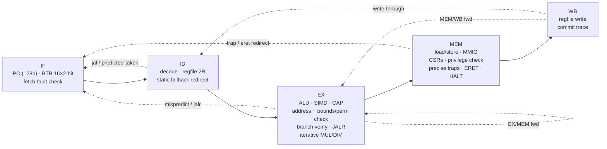

# TACHYON-128

**A real, working 128-bit CPU architecture — ISA, toolchain, golden model and a pipelined RTL core,
verified against each other.**

> 中文简介：TACHYON-128（超光速子-128）是一个从零设计的 128 位 CPU 架构：64 个 128 位寄存器、128 位地址空间、
> 定长 32 位指令；三大特色是 **硬件能力指针（CHERI 风格，边界+权限检查，不可伪造）**、**寄存器内 SIMD 通道**
> （16×8/8×16/4×32/2×64）和 **宽立即数拼接**。v2 新增：**带标签内存**（`clc`/`csc`，每 16 字节一个影子 tag+元数据）、
> **PCC 取指能力检查**（`cjalr`）、**密封能力**（`cseal`/`cunseal`）、**radix-4 提前终止除法器**、**确定性定时器中断**。
> **v3 新增**：**4 遍 radix-2³² 乘法器**（6 周期，原 35 周期）、**密封入口能力 sentry 与 `cinvoke` 保护域调用**、
> **`clc` 深度只读权限衰减**、**用户/内核两级特权**（`ecall`、特权违例陷阱、用户态 MMIO 只能经能力访问，附带抢占式双任务小内核示例）、
> **分支目标缓冲 BTB + 2 位饱和计数器预测**。
> 包含 Python 汇编器/反汇编器/黄金模拟器，SystemVerilog 五级流水线核心，用 Verilator 与黄金模型逐条提交轨迹对比，全部测试通过；Yosys 综合给出单元数。
> 详细规范见 [SPEC.md](SPEC.md)（顶部有中文摘要）。

| | |
|---|---|
| Registers | 64 × 128-bit GPRs (`r0` = 0), each a *fat register* with a hidden capability tag + perms + base + top |
| Address space | 128-bit virtual, byte addressed, little-endian; 128-bit PC |
| Encoding | fixed 32-bit (op6 · rd6 · rs1·6 · rs2·6 · func8) — see SPEC §1.1 for why not 64-bit |
| Integer | add/sub/logic/shifts/compare/min/max/clz/ctz/popcnt, **128-bit mul, mulhu, div, divu, rem, remu** (v3: 6-cycle 4-pass multiplier) |
| Memory | 8/16/32/64/128-bit loads (signed/unsigned) and stores, naturally aligned |
| Feature 1 | **Capabilities** — CHERI-style unforgeable, monotonic, bounds- and permission-checked pointers; **v2:** tagged memory (`clc`/`csc`, shadow tag + metadata per 16-byte granule), capability-checked instruction fetch (PCC, `cjalr`), sealed capabilities (`cseal`/`cunseal`); **v3:** sealed entry capabilities (`csealentry`, sentry `cjalr`), `cinvoke` sealed code+data domain calls, deep read-only `clc` attenuation |
| Feature 2 | **SIMD-in-GPR** — 16×8, 8×16, 4×32, 2×64 lanes: add/sub (wrap + saturating), min/max, compare masks, mul, splat, horizontal sum, shifts |
| Feature 3 | **Wide immediates** — `wli`/`wins` deposit 16 bits into any of 8 slots; `li` picks the shortest sequence |
| Traps | illegal, cap-tag, cap-bounds, cap-permission, misaligned, access-fault, cap-sealed, **v3:** environment-call, privilege-violation; precise; `tvec/epc/cause/tval/status/ubase/ubound`, `eret` |
| Privilege | **v3:** supervisor + user mode (`status.U/PU`), `ecall`; user mode cannot touch CSRs, `eret`, `halt`, `csetepcc`, and reaches memory/MMIO through untagged pointers only inside `[ubase, ubound)` — devices only through capabilities the kernel grants |
| Interrupts | **v2:** machine timer — `mtime` = retired-instruction count (deterministic), `mtimecmp`, `status.IE/PIE/TIE`, precise delivery |
| I/O | MMIO page at the very top of the 128-bit space: console, hex printer, exit, mtime, mtimecmp |

## Quickstart

```bash
# toolchain (no root needed): Verilator + C++ compiler from conda-forge, Yosys as WebAssembly
bash tb/setup_toolchain.sh && source ~/env.sh     # micromamba env "hdl" + yowasp-yosys

# assemble, disassemble, run on the golden model
python3 tools/asm.py programs/fib.s -o build/fib.bin --lst build/fib.lst
python3 tools/disasm.py build/fib.bin | head
python3 tools/sim.py build/fib.bin            # prints fib(180) = 18547707689471986212190138521399707760

# build the RTL model and run the whole differential test suite
make build           # Verilator model of tb/tb.sv + rtl/*.sv  -> build/vtb/Vtb
make test N=2000     # tool tests, unit tests, demo programs, 2000 random programs
make mutants         # inject 33 known RTL bugs, confirm the suite catches each
make synth           # Yosys generic-gate synthesis -> build/synth_stat.txt
```

Example output (golden model and RTL produce byte-identical console output):

```
fib(93) = 12200160415121876738
fib(94) = 19740274219868223167            <- first one past 64 bits
fib(180) = 18547707689471986212190138521399707760
34! = 295232799039604140847618609643520000000
high word of 34!*35 (mulhu) = 30          <- 35! no longer fits in 128 bits
dot(1..8,8..1)  = 00000000000000000000000000000078     (vmul.h + vsum.h)
vaddus.b (sat)  = fffffffffffffffffff0e0d0c0b0a090
bounded cap length = 64
  !! trap cause=3 addr=...270             <- store one past the end of a 64-byte capability
  !! trap cause=3 addr=...230             <- attempt to widen the capability
  !! trap cause=4 addr=...230             <- store through a read-only view
tag after mv (forge attempt) = 0
nodes walked        = 6                  <- caplist: linked list of capabilities spilled with csc / reloaded with clc
payload sum         = 00000015000000000000000000000015
nodes after forge   = 3                  <- an integer store into a link cleared the granule's tag: list is cut
  !! trap cause=2 / 3 / 4                <- forged pointer, neighbour access, csc through a load-only view
....................                     <- timer: one '.' per interrupt (mtime counts retired instructions)
timer ticks       = 20
TACHYON-128 kernel: 2 user tasks, timer quantum 200        <- kernel: supervisor + two preempted user tasks
Aabcd0efgh ijklAmn                                          <- task A via ecall, task B via a console capability
[kernel] task 1 killed: cause=9 tval=ffffffffffffffffffffffffffff0000   <- untagged MMIO store from user mode
1 A2 A3 A4 A5 A6 A7 A8 A9
[kernel] exit from task 0
[kernel] all tasks finished. preemptions=34 ecalls=32 taskA counter=10
```

## Repository layout

```
SPEC.md               ISA specification (English, Chinese summary on top)
tools/isa.py          single source of truth: opcodes, funcs, CSRs, causes, memory map
tools/asm.py          two-pass assembler: labels, expressions, .include, data directives, pseudo-ops
tools/disasm.py       disassembler
tools/sim.py          golden reference ISA simulator (writes the commit trace)
programs/*.s          lib.s runtime + fib, fact, sort, simd, capfault, caplist (tagged memory), timer (interrupts),
                      kernel (v3: supervisor/user, two preempted user tasks, ecall, capability-granted MMIO)
rtl/tx_core.sv        5-stage pipeline, register file, CSRs, traps/interrupts, PCC, capability + memory checks, timer
rtl/tx_alu.sv         128-bit ALU
rtl/tx_simd.sv        SIMD unit (per-width lane arrays)
rtl/tx_muldiv.sv      4-pass radix-2^32 multiplier, radix-4 early-terminating divider, result cache
rtl/tx_defs.svh       constants (checked against tools/isa.py by tests/test_tools.py)
tb/                   Verilator testbench: RAM + shadow tag memory, MMIO console, trace writer, C++ driver, toolchain setup
tests/                harness, directed unit tests, random generator, mutation check, runner, coverage.py
synth/                Yosys scripts
```

## Microarchitecture



```
            +------+    +------+    +--------------------+    +---------+    +------+
  PC(128) ->|  IF  |--->|  ID  |--->|         EX         |--->|   MEM   |--->|  WB  |
            +------+    +------+    | ALU  SIMD  CAP  AGU|    | D-port  |    +------+
               ^          |  ^      | BR   MUL/DIV(iter) |    | CSR/trap|       |
               |          |  |      +--------------------+    +---------+       |
               |          |  +---- regfile 64 x {128b value + 261b capability} <+
               +----------+------------- redirects: ID (jal, backward br), EX (mispredict, jalr),
                                          MEM (trap, eret, halt)
```

* **Forwarding:** EX/MEM → EX and MEM/WB → EX (value *and* capability metadata); register file writes through to ID.
* **Interlocks:** 1-cycle bubble for load-use and CSR-read-use; the front end stalls while MUL/DIV iterates.
* **Branches (v3):** a 16-entry direct-mapped **branch target buffer** with 2-bit saturating counters predicts taken
  branches, `jal` and `jalr` (last target, e.g. returns) in IF with no bubble. On a BTB miss ID falls back to the
  v2 static rule (JAL and backward branches redirect, 1 bubble). Every instruction carries its predicted next pc;
  EX compares it with the real one and redirects on any difference (2-cycle penalty), so aliasing or stale targets
  only cost time. `cjalr`/`cinvoke` always redirect from EX (they switch the fetch PCC). `+define+TX_NO_BTB` = v2.
* **MUL/DIV:** **v3 multiplier:** 4 passes of a 128 × 32 partial-product array into a 256-bit accumulator
  (6 cycles in EX, was 35 with v2's radix-16 shift-add; `+define+TX_MUL_BITS=4` rebuilds the v2 datapath). **v2 divider:** radix-4 restoring
  (4R+d compared against B, 2B, 3B in parallel), two radix-4 steps chained per cycle by default (4 quotient
  bits/cycle; `+define+TX_DIV_STEPS=1` = plain radix-4), with operand-normalised early termination — only
  `sig(|a|) − sig(|b|) + 1` quotient bits are computed. Latency ≈ `ceil(n/4) + 2` cycles (≤ ≈34, was ≤ 129 in v1);
  instant divide-by-zero; one-entry result cache so `remu` after `divu` (or `mulhu` after `mul`) is free.
* **Tagged memory:** the data port carries a 281-bit metadata side-band; the testbench memory system keeps one
  shadow entry {tag, otype, perm, base, top} per 16-byte granule. `csc` writes it, every other RAM store writes 0
  (clearing the tag), `clc` returns it (forwarded like any load, with the load-use interlock).
* **PCC:** a fetch-side PCC (updated with the `cjalr` redirect in EX) checks EXEC + bounds on every fetch; the
  architectural PCC/EPCC are updated in MEM so traps and interrupts save the right one.
* **Interrupts:** the timer condition is evaluated against the instruction in MEM — the oldest one, after all older
  instructions have updated `mtime` (retire count), `mtimecmp` and `status` — and the interrupt replaces it before it
  has any effect. Because `mtime` counts retirements, delivery lands exactly where the ISA model puts it.
* **Privilege (v3):** `status.U/PU`; the privilege check runs in MEM against the architectural mode (mode only
  changes at traps and `eret`, which flush younger instructions), turning a privileged instruction or an untagged
  user access outside `[ubase, ubound)` into a cause-9 trap that replaces whatever EX found.
* **Sentries / `cinvoke`:** share the `cjalr` path — EX redirects to rs1's cursor and installs rs1 *unsealed* as the
  fetch PCC; the link (a sentry for sentry calls) or the unsealed data capability is the rd result. `clc` through a
  read-only authority masks STORE/STORE_CAP off the loaded metadata in MEM.
* **Traps** are taken in MEM, so they are precise; younger instructions are flushed; stores and MMIO side effects
  only happen for non-trapping instructions in MEM.
* **Register file:** value and metadata arrays without reset (they map to memory macros) plus 64 "written" bits, so
  architectural reset (all zero, `rc` = root capability) costs 64 flops, not 26 000.

## Verification

The golden model writes a **commit trace** — one line per retired instruction (`pc rd value tag [perm base top otype]`),
one line per trap (`T cause epc tval`) and one per interrupt (`I code epc`). The Verilator testbench writes the
same trace from the WB stage. For every test the harness requires: identical traces (lock-step architectural state,
including capability metadata and every interrupt delivery point), identical console bytes, identical final 256 KiB
RAM image, **identical shadow tag memory** (every tagged granule with its metadata), identical retired count and exit code.

| Suite | Result | Notes |
|---|---|---|
| Tool self-tests (`tests/test_tools.py`) | **PASS** | 75 ISA constants in sync between Python and RTL (opcodes incl. `ecall`, counts, causes 1–9, ALU + CAP funcs, MMIO); 1054 random `li` constants exact (avg 3.35 instr); 12 973-instruction disasm→asm round trip |
| Directed unit tests (`tests/unit_tests.py`) | **164 / 164** | v2's 150 + 14 new: multiplier passes (`md_mul_passes0/1`, `haz_mul_abort`), sentries (`sentry_ops`, `sentry_hazards`), `cinvoke_ops`, `clc_attenuate`, privilege (`priv_basic`, `priv_mem`, `priv_irq`), BTB (`btb_patterns`, `btb_jalr_targets`, `btb_alias`, `btb_traps`) |
| Demo programs | **8 / 8** | fib(180), 30!..34! exact (+mulhu overflow), 24×128-bit sort, SIMD, capability faults, caplist, timer, **kernel** (v3: two user tasks preempted round-robin, ecall putc/exit, console through a granted capability, task killed with cause 9 for an untagged MMIO store; output and preemption count checked against the trace) |
| Random differential (`tests/random_tests.py`) | **2000 / 2000** (+ 2000/2000 on seeds 100001…) | 2 999 214 instructions retired (seeds 1…2000). New v3 streams: `mulw` (32-bit-chunk edge operands, chained products), `cinvoke` (sealed pairs, otype mismatch, unsealed/sentry/EXEC faults, return sentries), sentry `cjalr` calls, read-only `clc` authorities, `user` blocks (privileged ops, hybrid accesses around a random `[ubase, ubound)`, MMIO, `ecall` back), `bpat` (data-dependent inner branches), `call` (shared subroutines from many sites). Per 1000 programs (golden, `tests/coverage.py`): 18 700 interrupts; traps of all 9 causes (3 996 ecall, 9 093 privilege-violation, 1 313 cap-sealed …); 1 218 successful `cinvoke`s (2 697 faulting), 1 185 sentry calls, 5 335 `csealentry`, 121 attenuated `clc` results |
| Mutation check (`tests/mutants.py`) | **33 / 33 caught** | v2's 20 (branch-verification mutant re-targeted at the new EX check) + 13 new: multiplier carry dropped / stale last pass, sentry link not sealed, `cinvoke` without otype match, no `clc` read-only attenuation, PCC keeps the sentry seal, `csrr` allowed in user mode, no lower user-window check, `eret` not restoring the mode, `csrw` able to set U, privilege-faulting store not squashed, BTB not-taken mispredict uncorrected, `jalr` target verified on low bits only (`results/mutants.txt`) |

### Performance (cycle-accurate RTL, CPI = cycles / retired instructions)

| Workload | Cycles v3 | Retired | **CPI v3** (BTB + 4-pass mul) | CPI v3 without BTB (`TX_NO_BTB`) | CPI v2 |
|---|---:|---:|---:|---:|---:|
| fib (7 Fibonacci numbers, decimal printing) | 8 824 | 6 476 | **1.363** | 1.519 | 1.52 |
| fact (30!..34!, decimal printing, 128-bit `mul`) | 6 489 | 2 838 | **2.286** | 2.472 | 2.83 |
| sort (24 × 128-bit keys, LCG uses `mul`) | 1 985 | 1 564 | **1.269** | 1.389 | 1.83 |
| simd demo | 1 148 | 916 | **1.253** | 1.429 | 1.43 |
| capfault demo | 1 390 | 1 073 | **1.295** | 1.452 | 1.45 |
| caplist demo (tagged memory) | 1 960 | 1 537 | **1.275** | 1.419 | 1.42 |
| timer demo | 6 277 | 5 824 | **1.078** | 1.259 | 1.26 |
| kernel demo (v3, two preempted user tasks) | 47 397 | 40 630 | **1.167** | 1.288 | — |
| all 8 programs | 75 470 | 60 858 | **1.240** | 1.376 | — |
| all 164 unit tests | 26 990 | 17 946 | **1.504** | 1.569 | — |
| 2000 random programs (v3 generator) | 4 925 766 | 2 999 214 | **1.642** | 1.785 | — |

* **Multiplier:** fact 2.83 → 2.47 and sort 1.83 → 1.39 from the multiplier alone (columns 2 vs 3 only differ in the
  front end); a 128×128 `mul`/`mulhu` pair now costs 6 cycles instead of 35. fact stays the highest-CPI workload because
  decimal printing does `divu`/`remu` by 10 on 128-bit numbers (≈ n/4 + 2 cycles each).
* **BTB:** −10 % cycles over the programs (CPI 1.376 → 1.240): loop back-edges and forward-taken branches are
  predicted in IF with no bubble, and `ret` (`jalr`) is predicted from the last target, which is right for repeated
  calls from one site. The kernel's context-switch copy loop and the timer demo's tight loop gain most.

### Synthesis (Yosys 0.70, generic gates)

Full reports: `results/synth_stat_abc.txt` (hierarchical, ABC-mapped — `make synth`), `results/synth_stat_abc_nobtb.txt`
(`-DTX_NO_BTB`), `results/synth_stat_abc_mul_radix16.txt` (`-DTX_MUL_BITS=4`, v2 multiplier), `results/synth_stat_techmap.txt` (v2, techmap only).
The register file is kept as memory macros (`$mem_v2`, 64×128 b and 64×281 b, 2 read / 1 write), as a
real implementation would use a register-file compiler; the 16-entry BTB is mapped to flip-flops (`mem2reg`).

| Block (hierarchical, after ABC) | v3 cells | v2 cells |
|---|---:|---:|
| **tx_core total** | **145 247** | 113 509 |
| ├ tx_alu (128-bit ALU) | 8 740 ¹ | 8 124 |
| ├ tx_muldiv (4-pass 128×32 multiplier + radix-4 ×2 divider + result cache) | 39 267 | 17 235 |
| ├ tx_simd (8/16/32/64-bit lane arrays) | 48 052 | 48 052 |
| └ core glue (pipeline, BTB, forwarding, capability/PCC/seal/sentry checks, privilege, CSRs, timer, decode) | 49 188 | 40 098 |
| of which flip-flops | 8 188 | 7 042 |
| of which register-file memory macros (`$mem_v2`) | 3 | 3 |
| combinational gates | 137 056 | 106 464 |

¹ unchanged RTL; ABC's result for the ALU varies by ≈ ±600 cells between runs (8 124 in the `TX_NO_BTB` run).

* **Multiplier cell delta: +21 877 cells** (tx_muldiv 39 267 vs 17 390 for the radix-16 build of the same RTL,
  `TX_MUL_BITS=4`; core totals 145 247 vs 123 370). The extra area is the 128×32 partial-product array.
* **BTB:** ≈ +3 000 cells and +500 flip-flops (core 145 247 vs 141 646 with `TX_NO_BTB`, ALU noise removed).
* The rest of the glue growth (≈ +6 000) is the privilege logic (`ubase`/`ubound` CSRs and window comparators,
  status bits, privileged-instruction detection in MEM), the per-instruction predicted-next-pc registers, the
  sentry/`cinvoke` checks and the 5-bit CAP function decode.

## Known gaps (v3)

* No GLOBAL/LOCAL or separate LOAD_MUTABLE / PERMIT_CINVOKE permission bits (STORE doubles as the LM bit for `clc`
  attenuation; `cinvoke` authority is the otype match + EXEC split); EPCC is write-only, so a kernel tracks task PCCs.
* Two privilege levels only, one global user window (`ubase/ubound`, the kernel swaps it per task); user mode cannot
  read any CSR (not even `mtime`, unless given a capability to it).
* Capabilities keep full-precision bounds, so each 16-byte granule needs a 281-bit shadow entry (no CHERI-style
  bounds compression); `mtime` is a retired-instruction counter, not wall-clock time; single interrupt source.
* No MMU (flat 128-bit space, 256 KiB physical RAM), no FPU/atomics, no self-modifying-code fence (the BTB would
  need flushing too).
* The 4-pass multiplier costs ≈ 21.9 k generic cells over v2's radix-16 one (a Booth-recoded / Wallace array or
  sharing the SIMD lane multipliers would cut that); the BTB is tiny (16 entries, no return-address stack).
* Synthesis is technology-independent (no timing/area on a real cell
  library; the chained radix-4 divider step doubles the divider's critical path); no FPGA bring-up yet.
